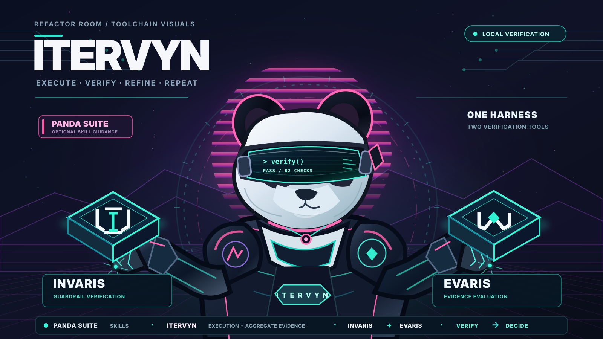

# Itervyn

Execute. Verify. Refine. Repeat.



Itervyn v0.1.0 is a local verification CLI for coding agents, terminal users and
CI. It runs trusted Invaris checks and evaluates explicitly identified imported
Evaris runs, validates their evidence, and records a structured decision. The
agent owns code changes and the correction loop.

Requires Linux or macOS and Go 1.27.4 to build. Runtime integrations support the
**Invaris 0.5.x** and **Evaris 0.4.x** release lines (see
[compatibility](docs/integration.md#compatibility)). Other builds fail closed. Only Invaris's
native v1alpha2 structured command `check` profile is supported. Evaris preparation
and import happen separately; command graders and embedded Invaris verification
are not authorized by Itervyn v0.1.0.

```sh
go build -trimpath -o /tmp/itervyn ./cmd/itervyn
/tmp/itervyn version --format json
/tmp/itervyn init
/tmp/itervyn doctor --format json
```

`init` never overwrites a file. It creates Itervyn configuration, not guard rules.
`doctor` reports missing tools/harnesses and may create a private permission probe;
it does not run verification beyond each provider's `--version`. Install the
upstream binaries separately, either from Go:

```sh
go install github.com/akkaraponph/invaris/cmd/invaris@v0.5.0
go install github.com/akkaraponph/evaris/cmd/evaris@v0.4.0
```

or from npm (`npm install invaris-cli@0.5 evaris-cli@0.4`). The npm `bin`
entries are Node.js launchers behind symbolic links, which Itervyn refuses; set
`executable` to the native binary inside the package instead:
`node_modules/invaris-cli/platforms/<os>_<arch>/invaris` and
`node_modules/evaris-cli/binaries/evaris-<os>-<arch>` (`<arch>` is `amd64` or `arm64`).

Put the Go installation directory on PATH, or use absolute executable paths in
configuration. These installation commands need network access unless cached.
Verification itself needs no network service; trusted external tools can still
access the network and filesystem.

Try the deterministic Go fixture in a disposable directory, from this checkout:

```sh
example_dir=$(mktemp -d)
cp -R examples/go-project/. "$example_dir/"
go build -trimpath -o "$example_dir/guard-bin" ./examples/go-project/guard
/tmp/itervyn verify --config "$example_dir/itervyn.json" --format json
```

The fixture initially passes. Change `SAFE` to `FORBIDDEN` in its `app.go`, verify
again to observe FAIL, then restore `SAFE` and verify again. Every invocation gets
a new private run directory. This marker guard demonstrates the protocol; it does
not establish general Go correctness. See the [example](examples/go-project/README.md).

```sh
itervyn verify --config itervyn.json --format json
itervyn inspect RUN_ID --config itervyn.json --format json
```

| Decision | Exit | Advisory next action |
| --- | --- | --- |
| PASS | 0 | COMPLETE |
| FAIL | 1 | FIX_AND_REVERIFY |
| INCONCLUSIVE | 2 | INVESTIGATE (STOP when canceled) |
| ERROR | 2 | STOP |

Read JSON as well as the exit code. Required failures cannot be overridden by
passing evaluations. Optional failures warn. Missing mandatory evidence cannot
pass; a publication error overrides the aggregate with ERROR. An imported Evaris
run and the live project are **different subjects**. PASS means the configured
criteria passed for their recorded scopes, not that an older imported run proves
the correctness of a newer edit.

Runs live under `.itervyn/runs/<id>/`. Original provider output, configuration,
hashes and execution identity are private. `inspect` checks the committed result
and referenced bytes without executing providers. Missing commit markers mean an
incomplete run. Hashes identify bytes; they do not authenticate tools or agents.

Panda Suite supplies optional engineering instructions; Invaris owns guard logic;
Evaris owns grading; Itervyn owns execution and aggregate evidence. No Panda Suite
skill or AI host is required. There is no autonomous correction or agent runtime.

Read [configuration](docs/configuration.md), [architecture](docs/architecture.md),
[terminal/agent/CI integration](docs/integration.md), [security](docs/security.md),
[release contracts](docs/release.md), and [contributor checks](CONTRIBUTING.md).
Original Itervyn code is Apache-2.0; see [LICENSE](LICENSE).
